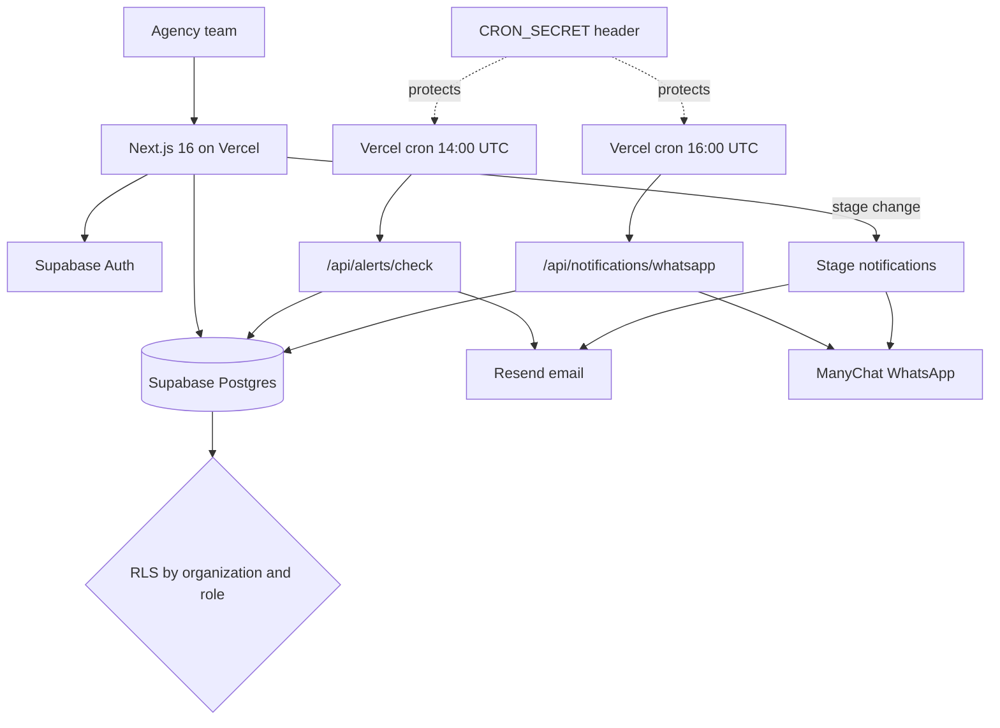

# Real Estate Transaction CRM

A multi-tenant CRM for real estate agents in Mexico who handle properties that need a long legal process before they can be sold (probate, mortgage release, appraisal, notarization). Each property moves through a configurable pipeline of stages, and the system alerts the team when a property stalls or an action is due.

> The source code is private because it was built for a client. This page describes the product and architecture. All example data is fictional.

## The problem

These sales involve many legal steps, documents and people. Without a shared tracker, properties sit idle in a stage nobody is watching, and the team finds out when the client calls.

## What it includes

- **Configurable stages and documents:** each organization defines its own stages, required documents, deadlines and message templates.
- **Property tracking:** per-property stage state, contacts, notes, documents and a full stage history with the author of each change.
- **Alerts on stalled properties:** a daily job finds properties that have been in a stage too long and notifies the right people.
- **Email and WhatsApp notifications:** stage-change messages and reminders by email (Resend) and WhatsApp (ManyChat), with delivery leases so the same message is not sent twice.
- **Finance view:** income and expenses recorded per property, with balance and per-user totals.
- **Role matrix:** `admin`, `socio`, `asistente` and `asesor`, where an advisor only sees the properties assigned to them. Enforced in the database with Row Level Security, not only in the UI.
- **Invitations and user administration** per organization.

## Architecture

## Tech stack

- **Next.js 16** (App Router), **React 19**, **TypeScript**, **Tailwind CSS 4**
- **Supabase:** Auth, Postgres and Row Level Security
- **Resend** (email) and **ManyChat** (WhatsApp)
- **Vercel** with cron jobs

## Highlights

- **Security model:** multi-tenant isolation and a per-role permission matrix implemented as RLS policies, with dedicated tests for access rules and permissions.
- **Reliable notifications:** claim and lease logic so concurrent cron runs do not double-send, plus safety tests around the WhatsApp provider.
- **Evolving schema:** over twenty numbered SQL migrations covering stages, history, atomic stage transitions and policy fixes.
- **Test coverage:** a dozen test files covering notifications, templates, permissions, store mutations and a database integration suite.

[Back to profile](https://github.com/Ernesto-9)

See more projects on my [GitHub profile](https://github.com/Ernesto-9).
